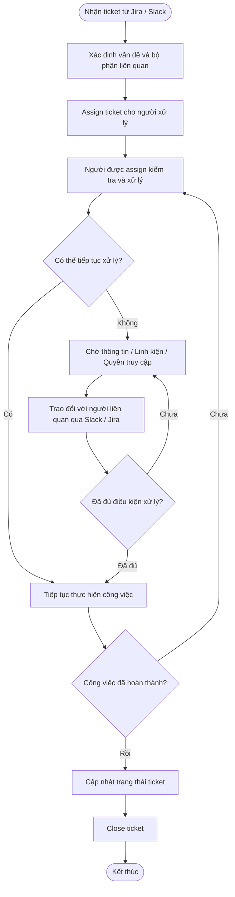
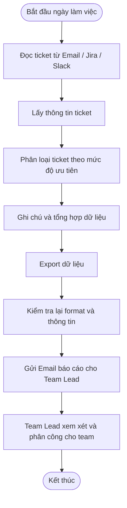
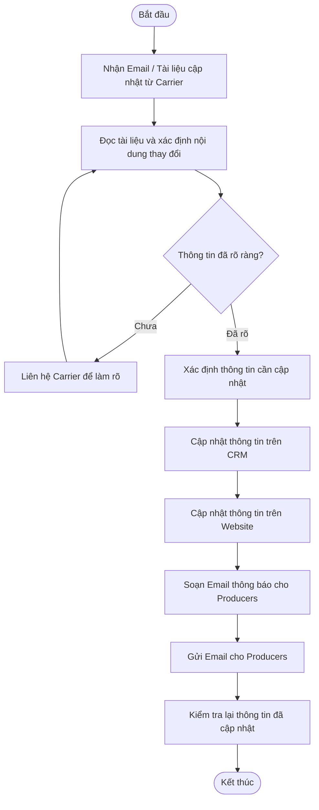

# Báo cáo cá nhân — MSSV_HoTen

> Đổi tên file theo quy tắc `MSSV_HoTen.md`, ví dụ `20241234_NguyenVanAn.md` (MSSV trước, dấu `_`, họ tên viết liền không dấu). Sửa cả dòng tiêu đề phía trên cho khớp.
> Template chi tiết và prompt mẫu cho từng mục: [docs/01-worksheet.md](../../docs/01-worksheet.md).

## 1. Thông tin học viên

- Họ tên: Trần Thanh Long
- MSSV: 2A202603674
- Email trường (không bắt buộc, repo có thể để public): 26ai.longtt2@vinuni.edu.vn
- Tên nhóm: HTL
- Link repository: https://github.com/Monstucture/K5-L3A-DAY02-HTL-2A202603674-DiscoveryProblemFraming/tree/individual/Long

---

## 2. Scan problem (CP1)

Nhân vật: Long IT Support ở công ty chuyên về mua bán bảo hiểm khoảng 100 người dùng Jira, Slack (pro), Google sheets, CRM riêng. Mỗi ngày cần xem và phân loại ticket, oncall support cho các Producer gặp trục trặc kỹ thuật, họp với đại diện từ các nhà bảo hiểm để update chính sách trên web công ty và hồ sơ nội bộ

Lăng kính: **Lặp lại** · **Tốn thời gian** · **Cần đọc, tổng hợp nhiều thông tin** · **Pain từ người khác**.

| # | Lăng kính | Job Story: Khi… tôi muốn… để… | Ai chịu ảnh hưởng? | Dấu hiệu thật (thời gian, tần suất, số người, bằng chứng) |
|---:|---|---|---|---|
| 1 | lặp lại | Check support ticket mỗi đầu giờ làm và phân loại mức độ nghiêm trọng cho mỗi ticket và những job chưa làm ngày hôm trước để phân công cho team làm| Cả team | Ít ticket thì 10'-20' còn nhiều thì 30'-1h|
| 2 | Pain từ người khác | Team customer support cần thông tin khách hàng, số liệu và ngày contact từ phía Producer để giải quyết câu hỏi về dịch vụ và benefit | Customer Support, IT | 3/10 Producer không nhập thông tin lên CRM thì customer support không có thông tin và email thì mất thời gian trong khi khách trên phone |
| 3 | Lặp lại | Khi một Insurance Carrier thay đổi thông tin sản phẩm hoặc chính sách, tôi muốn xác định những trang web và tài liệu nội bộ cần cập nhật, để không bỏ sót nội dung liên quan | IT | Số lần cập nhật thiếu số trang/tài liệu bị bỏ sót, chưa update trên web |
| 4 | Tốn thời gian | Khi Producer báo lỗi kỹ thuật qua Slack, tôi muốn xác định được đầy đủ thông tin về thiết bị, trình duyệt, tài khoản và thời điểm xảy ra lỗi, để không phải hỏi đi hỏi lại nhiều lần | IT | Trao đổi trung bình 10 lần và mất trung bình 30' tới lúc sử lý |
| 5 | Cần đọc nhiều | Khi Insurance Carrier gửi email thông báo thay đổi chính sách bảo hiểm, tôi muốn xác định chính xác những điều khoản, quyền lợi và điều kiện nào đã thay đổi, để không phải đọc lại toàn bộ tài liệu mỗi khi cập nhật | IT, Customer | Thời gian đọc tầm 20' cho thay đổi ít và 1 tiếng với thay đổi nhiều và xác định thay đổi để báo với các khách hàng có policy |
| 6 | Tốn thời gian | Khi kết thúc ngày làm việc, tôi muốn biết những ticket nào chưa được xử lý hoặc đang chờ phản hồi, để không phải kiểm tra lại từng ticket vào ngày hôm sau | IT | khoảng 10' mỗi ngày có khi miss ticket vì IT được assign hôm trước chưa báo cáo |
| 7 | Pain từ người khác | Khi Insurance Carrier chưa phản hồi về một câu hỏi liên quan đến chính sách hoặc tích hợp hệ thống, tôi muốn biết những yêu cầu nào đang chờ họ phản hồi, để không bỏ quên các công việc phụ thuộc vào đối tác | IT Support, Operations | 5-10 yêu cầu chờ phản hồi, thời gian chờ trung bình khoảng 1-2 tuần nếu tính ngày không làm việc |
| 8 | Pain từ người khác | Khi một ticket được giao cho một thành viên trong team IT, tôi muốn biết ticket đang được xử lý, đang chờ thông tin hay chưa được bắt đầu, để tránh tình trạng mọi người nghĩ người khác đang làm. | IT team lead | 20+ ticket không có người xử lý, thời gian ticket nằm im khoảng 1-2 tiếng tới 5-10 ngày; đã giải quyết mà ko ai update khoảng 2-5 ticket  |

**Nếu có dùng AI để gợi ý thêm:** ý nào AI gợi ý mà bạn giữ lại, ý nào bỏ và vì sao.

- Ý 4 và ý 7, 8  giữ lại vì thấy vướng mắc trong công việc với lại thời gian sử lý chậm

- AI gợi ý Khi Insurance Carrier thông báo một chính sách mới có hiệu lực vào ngày cụ thể, tôi muốn biết những thay đổi nào phải hoàn tất trước ngày đó, để tránh việc website hoặc tài liệu nội bộ vẫn hiển thị thông tin cũ khi chính sách có hiệu lực. Không giữ tại vì phụ thuộc vào thời gian của toàn đội thay vì vướng bởi task cá nhân

---

## 3. Top 3 Problem Cards + quy trình nháp (CP2)

### Bảng chọn top 3

| Rank | Problem | Vì sao chọn | Điều còn chưa chắc |
|---:|---|---|---|
| 1 | Cần biết tình trạng ticket (#8) | Vướng nhiều người và nhiều quy trình chưa thể giải quyet vì thiếu linh kiện và chưa được phép xử lý | Nhiều người được phân xử lý cùng 1 task nhưng lúc assign thì không reassign ticket cũng như ko close |
| 2 | Check ticket (#1) | Quy trình cần sự tỉ mỉ tốn thời gian vì những ticket cũ lẫn trong Jira | nhiều ticket không chắc phần nào cần đư lên đầu và xử lý trước và cần ý kiến từ lead |
| 3 | Đọc và update tài liệu (#5) | Cần update nhiều phía từ CRM cho tới web và gửi mail cho các Producer đang bán | Không chắc truyền đạt được yêu cầu |

### Problem Card #1

| Trường | Nội dung |
|---|---|
| Job Story | Khi có nhiều ticket đang được xử lý đồng thời, tôi muốn biết mỗi ticket đang ở trạng thái nào, ai chịu trách nhiệm chính và đang bị vướng ở đâu, để đảm bảo công việc được tiếp tục xử lý và không bị bỏ quên |
| Actor | IT Support / IT Team Lead |
| Thời điểm / bối cảnh | Trong ngày làm việc, khi theo dõi ticket đang mở, khi có người bàn giao công việc hoặc khi cần kiểm tra tiến độ của team |
| Quy trình hiện tại (3–7 bước) | 1. Nhận ticket từ Jira hoặc yêu cầu hỗ trợ qua Slack. 2. Xác định người hoặc bộ phận liên quan. 3. Assign ticket cho người xử lý. 4. Người xử lý kiểm tra và thực hiện công việc. 5. Nếu thiếu linh kiện, quyền truy cập hoặc thông tin, công việc bị chờ. 6. Các thành viên trao đổi tình trạng qua Slack hoặc Jira. 7. Kiểm tra lại ticket và cập nhật trạng thái khi hoàn thành |
| Bottleneck (bước nào, mất bao nhiêu phút) | Bước cập nhật trạng thái và người phụ trách. Có trường hợp nhiều người cùng tham gia một task nhưng không rõ ai chịu trách nhiệm chính; ticket không được reassign hoặc close khi công việc đã thay đổi trạng thái |
| Impact (nếu không giải thì sao) | Ticket có thể nằm im dù đã có người xử lý; nhiều người tưởng người khác đang phụ trách. Lead khó xác định công việc đang bị tắc ở đâu và ai cần tiếp tục xử lý |
| Success metric (baseline → target) | Cần xác minh số ticket không có owner rõ ràng, ticket không cập nhật trạng thái và thời gian nằm im. Target: 100% ticket đang mở có người phụ trách chính và trạng thái phản ánh đúng tình hình thực tế|
| Phương án không dùng AI | Sử dụng quy trình quản lý ticket thống nhất, trong đó trạng thái, người phụ trách và lý do chờ xử lý được ghi nhận rõ ràng |
| Giả thuyết về AI (nếu có) | AI có thể đọc nội dung trao đổi liên quan đến ticket để nhận diện khi có thay đổi người phụ trách, công việc bị block hoặc đã hoàn thành nhưng trạng thái ticket chưa được cập nhật |
| Cảm nhận nhanh | Rule |

Quy trình nháp hiện tại:

### Problem Card #2

| Trường | Nội dung |
|---|---|
| Job Story | Sáng mỗi ngày tôi muốn có số lượng ticket và mức độ cần giải quyết cũng như bô phận cần giải quyết của những ticket, lọc đi nhưng ticket chưa được giải quyết và đã assign để gửi cho team lead trước 10h |
| Actor | IT support được assign |
| Thời điểm / bối cảnh | Sáng mỗi ngày trước 10h |
| Quy trình hiện tại (3–7 bước) | 1. Đọc ticket từ mail, jira, slack (nếu được nhắn riêng) 2. Phân loại theo thứ tự mức độ cao -> thấp để xử lý và note 3. Export dữ liệu 4. Review lại fomat 5. Gửi mail |
| Bottleneck (bước nào, mất bao nhiêu phút) | Bước phân loại vì nhiều ticket trùng và ticket cũ đã assign mà chưa giải quyết mất tầm 20-30' |
| Impact (nếu không giải thì sao) | Mất 1-2 tiếng và miss ticket chưa xử lý qua ngày tiếp theo, nhiều IT không được assign |
| Success metric (baseline → target) | Hiện tại mất khoảng 30' - 1 tiếng đễ xử lý -> target tự đông và đầy đủ thông tin chỉ gửi cho lead sau khi được review  |
| Phương án không dùng AI | Tạo 1 trang chung để mọi người dùng công cụ hiên có để tập hợp luồn thông tin từ 1 phía giảm thời gian thu thập dữ liệu|
| Giả thuyết về AI (nếu có) | AI đọc và phân loại ticket cũng như thu thập thông tin trên ticket về vấn đề, mẫu mã máy nếu có trước khi assign để người được assign khỏi phải tìm lại thông tin |
| Cảm nhận nhanh | Workflow |

Quy trình nháp hiện tại:

### Problem Card #3

| Trường | Nội dung |
|---|---|
| Job Story | Khi nhận được thông báo thay đổi chính sách hoặc quyền lợi từ Insurance Carrier, tôi muốn xác định những thông tin nào thay đổi, những hệ thống và tài liệu nào bị ảnh hưởng, để đảm bảo thông tin trên website, CRM và tài liệu nội bộ được cập nhật chính xác trước ngày áp dụng |
| Actor | IT Support |
| Thời điểm / bối cảnh | Khi Insurance Carrier gửi thông báo chính sách mới, thay đổi quyền lợi, điều kiện tham gia hoặc thông tin sản phẩm |
| Quy trình hiện tại (3–7 bước) | 1. Nhận email hoặc tài liệu cập nhật từ Insurance Carrier. 2. Đọc và xác định những thông tin thay đổi. 3. Trao đổi với đại diện Carrier nếu có nội dung chưa rõ. 4. Xác định các trang web và hồ sơ nội bộ cần cập nhật. 5. Cập nhật thông tin trên các hệ thống liên quan như CRM và website. 6. Gửi email thông báo cho Producer về thay đổi mới. 7. Kiểm tra lại nội dung sau khi cập nhật |
| Bottleneck (bước nào, mất bao nhiêu phút) | Bước đọc tài liệu và xác định phạm vi ảnh hưởng. Thông tin có thể nằm ở nhiều tài liệu, email và phiên bản khác nhau. Khó xác định đầy đủ những nội dung cần cập nhật và những Producer cần được thông báo|
| Impact (nếu không giải thì sao) | Thông tin giữa website, CRM và tài liệu nội bộ có thể không đồng nhất. Producer có nguy cơ tiếp tục sử dụng chính sách cũ khi tư vấn khách hàng. Công ty có thể mất thời gian sửa đổi và gửi lại thông tin |
| Success metric (baseline → target) | Đo thời gian từ khi nhận thông báo đến khi xác định và hoàn thành các cập nhật track số lần phải sửa lại và số nội dung bị bỏ sót. Mục tiêu là 100% thay đổi quan trọng được xác định, có danh sách nội dung cần cập nhật và hoàn thành trước ngày hiệu lực theo quy trình được phê duyệt |
| Phương án không dùng AI | Sử dụng quy trình theo dõi thay đổi chính sách, ghi nhận nguồn tài liệu, ngày hiệu lực, nội dung cần cập nhật và người chịu trách nhiệm |
| Giả thuyết về AI (nếu có) | AI có thể đọc và so sánh tài liệu chính sách mới với phiên bản trước, xác định những nội dung thay đổi và các thông tin có thể ảnh hưởng đến website, CRM, tài liệu nội bộ và Producer |
| Cảm nhận nhanh | Workflow |

Quy trình nháp hiện tại:

### Card muốn pitch nhất

- Card số: 3
- Vì sao: Vì lệ thuộc vào nhiều phía và phải trao đổi nhiều ngày để trong khi phải đảm bảo kịp tiến độ
- Câu hỏi muốn nhóm phản biện: 

### AI đã phản biện card thế nào

| Điểm yếu AI chỉ ra | Đồng ý? | Đã sửa gì |
|---|---|---|
| Chưa xác định rõ ai là người chịu trách nhiệm cập nhật trạng thái và vì sao họ không làm điều đó | Không đồng ý | Task update được giao trực tiếp cho người được assign|
| Đang gộp nhiều công việc khác nhau thành một vấn đề lớn, chưa xác định bottleneck thực sự | Đồng ý | Task trao đổi và sửa dược giao bởi 1 người không có metric đánh giá tốt
| Chưa chứng minh được vấn đề nằm ở quy trình tổng hợp ticket hay ở cách quản lý ticket trong Jira | Đồng ý | Quy trình tổng hợp thông tin và quản lý ticket đều bottle neck

---

## 4. Tôi đã tham gia phần nào (CP3 → CP7)

| Hoạt động | Tôi đã làm gì? | Kết quả / ảnh hưởng tới bài nhóm |
|---|---|---|
| Pitch Problem Card | | |
| Phản biện bài của bạn khác | Câu hỏi tôi đã đặt: | |
| Nhận phản biện | Câu hỏi tôi nhận được: | Tôi đã sửa gì: |
| Gom cluster / cây OST | | |
| Chọn candidate problem | | |
| Kiểm chứng / research | | |
| Quy trình nhóm | | |
| Problem Statement | | |
| Mức can thiệp AI | | |
| Quyết định | | |

---

## 5. Dùng AI

| Checkpoint | Tôi dùng AI để làm gì? | AI hữu ích ở đâu? | AI sai hoặc hời hợt ở đâu? | Tôi sửa gì bằng nhận định của mình? |
|---|---|---|---|---|
| CP1 Scan | | | | |
| CP2 Problem Card | | | | |
| CP4 Research | | | | |
| CP5 Quy trình | | | | |
| CP5–6 Problem Statement | | | | |
| CP6 Mức can thiệp / quyết định | | | | |

---

## 6. Reflection (CP7)

Trả lời bằng trải nghiệm thật của bạn, tối thiểu 200 từ cho các câu 6.1–6.6 (không tính 6.7, câu này được chấm riêng ở tiêu chí C5). **Không dùng AI để viết thay.**

**6.1. Tôi học được gì khi nghe top 3 problems của các bạn khác?**

**6.2. Nhóm có lúc nào bị "solution-first" (nghĩ giải pháp trước khi hiểu vấn đề) không? Lúc đó nhóm nhận ra và xử lý thế nào?**

**6.3. Tôi có đổi ý sau khi bị phản biện không? Kể một lần cụ thể.**

**6.4. Kết quả kiểm chứng (phỏng vấn/survey/research) có làm tôi bất ngờ không? Điều gì?**

**6.5. Điều khó nhất khi viết Problem Statement là gì?**

**6.6. Nếu làm lại, tôi sẽ đổi gì? Tôi sẽ phản biện nhóm mạnh hơn ở điểm nào?**

**6.7. Hiểu bài:** giải thích bằng 5–8 câu, không nhìn tài liệu, chuỗi *problem → quy trình → metric → boundary → mức can thiệp AI → quyết định* của bài nhóm mình.

---

## 7. Tài liệu tham khảo

-
