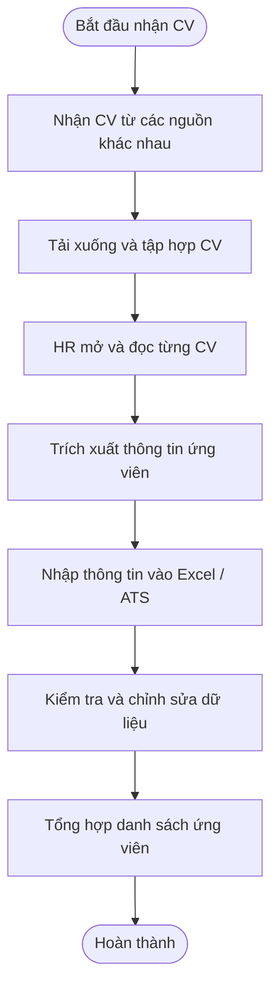
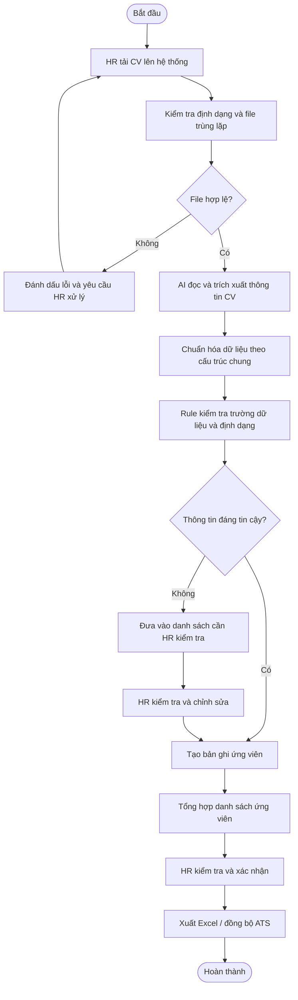

# Báo cáo nhóm — Day 02 Discovery & Problem Framing

> Bản chung của nhóm. Khi chốt bản cuối, **mỗi thành viên copy file này vào repo cá nhân**.
> Template chi tiết và prompt mẫu: [docs/01-worksheet.md](../../docs/01-worksheet.md). Bài mẫu: [docs/02-deliverable-example.md](../../docs/02-deliverable-example.md).

## 1. Thông tin nhóm

- Tên nhóm: HTL
- Tên nhóm: HTL
- Thành viên: xem `TEAM.md`
- Candidate problem được chọn (1 câu): Nhận nhiều CV với định dạng và fomat khác nhau thông tin cần được trích xuất và chuẩn hóa theo cùng một cấu trúc để dễ dàng tra cứu và có thể dùng các thông tinh được xuất làm dashboard dùng cho báo cáo/ phân loại
- Quyết định cuối: Go / Not Yet / No-Go

---

## 2. Hội tụ nhóm (CP3)

### 2.1. Pitch

| # | Người đưa ra | Candidate (Job Story ngắn) | Actor | Bottleneck | Câu hỏi phản biện nhận được (ai hỏi) |
|---:|---|---|---|---|---|
| 1 | Long | Lấy thông tin và đánh giá từ các Technical Staff để đưa ra quyết định sau nhiều vòng phỏng vấn | HR | Các ngày và vòng phỏng vấn rời rạc làm thiếu thông tin để đánh giá | |
| 2 | Long | Khi có nhiều ticket đang được xử lý đồng thời, tôi muốn biết mỗi ticket đang ở trạng thái nào, ai chịu trách nhiệm chính và đang bị vướng ở đâu, để đảm bảo công việc được tiếp tục xử lý và không bị bỏ quên | IT Support / IT Team Lead | Bước cập nhật trạng thái và người phụ trách. Có trường hợp nhiều người cùng tham gia một task nhưng không rõ ai chịu trách nhiệm chính; ticket không được reassign hoặc close khi công việc đã thay đổi trạng thái | Có nhất thiết phải sử dụng AI cho việc phân loại ticket? Thay vào đó, làm 1 trang web dashboard tổng hợp ticket chung (Tùng) |
| 3 | Hoàng | Khi một vị trí có khoảng 80-150 CV, tôi muốn biết tối thiểu ai phù hợp ở trong vị trí đó trong vòng 2 ngày | HR | Phụ trách tuyển dụng 3-4 người cùng một vị trí | Thời gian xủ lý 1 CV và tiêu chí thực để quyết dịnh người phù hợp cũng như số lượng (Long) |
| 4 | Hoàng | Khi đã chốt được những cá nhân được chọn thì sẽ sắp xếp một thời gian phỏng vấn phù hợp để không bị trùng lịch với người khác | HR | làm việc với trưởng bộ phận(phỏng vấn), ứng viên | |
| 5 | Tùng |  Khi có một lượng lớn CV gửi về công ty, cần một danh sách tổng hợp rõ ràng | HR | Tốn thời gian để nhập dữ liệu vào bảng tổng hợp với các trường cố định  *Họ tên, email...*. |  |
| 6 | Tùng | Quy trình trình ký và duyệt chi bị nghẽn do hóa đơn/chứng từ bản cứng chờ sếp duyệt trực tiếp, dẫn đến thanh toán chậm cho nhà cung cấp | Kế toán, Trưởng phòng, Ban Giám Đốc | Diễn ra liên tục hàng tuần, làm trễ hạn thanh toán và ảnh hưởng đến uy tín với đối tác | Quy trình thì bạn định dùng AI để duyệt những cái dễ hay AI để tóm tắt và sếp duyệt. Nều dùng AI thì bạn căn cứ vào những yếu tố nào để tự động duyệt (Long) |

### 2.2. Cluster

| Cluster | Các candidate | Pattern chung |
|---|---|---|
| A - Thu thập / tổng hợp CV | Nhận lượng CV từ nhiều nguồn như LinkedIN, topCV, timviecIT,...; phải tổng hợp thông tin tất cả ứng viên và xuất vào một danh sách | Thu thập thông tin từ nhiều CV và đưa về một nơi tập trung |
| B - Trích xuất / chuẩn hóa dữ liệu | Đọc CV, nhập thông tin; CV mỗi có định dạng khác nhau, thiếu thông tin, trùng lặp do họ gửi từ nhiều nguồn | Chuyển dữ liệu không đồng nhất thành cấu trúc thống nhất để dễ quản lý |
| C - Tìm kiếm / sàng lọc ứng viên | Lọc các CV đáp ứng yêu cầu tuyển dụng, xác định ứng viên phù hợp | Đánh giá lượng lớn thông tin để tìm ra những ứng viên phù hợp |
| D - Sắp xếp / điều phối lịch phỏng vấn | Sắp xếp lịch cho ứng viên và 3–4 người phụ trách tuyển dụng, tránh trùng lịch; xử lý lịch thay đổi | Trao đổi thời gian và lịch trình của nhiều người để tìm được khung giờ phù hợp |

### 2.3. Opportunity Solution Tree rút gọn

Gốc là **1 outcome**. Nhánh là **opportunity** (nhu cầu, pain), không phải tính năng hay công cụ.

```text
OUTCOME: Lấy hoàn chỉnh tất cả thông tin của các ứng cử viên vô trường tổng hơp trong một danh da sách để phân công xử lý cũng như track progress
├── Opportunity A: Khi nhận CV từ nhiều nguồn khác nhau, HR có thể tập hợp tất cả CV vào một nơi mà không phải tải xuống và nhập lại thông tin các ứng cử viên thủ công có thể là google sheets, JSON fomat hay phần mềm tương tự
├── Opportunity B: Nhận nhiều CV với định dạng và fomat khác nhau thông tin cần được trích xuất và chuẩn hóa theo cùng một cấu trúc để dễ dàng tra cứu và có thể dùng các thông tinh được xuất làm dashboard dùng cho báo cáo/ phân loại
└── Opportunity C: HR cần có thể tìm kiếm, lọc và theo dõi tình trạng xử lý của từng ứng viên để tránh bỏ sót trong quá trình tuyển dụng, cũng như lưu giữ hồ sơ để gọi khi team trống vị trí phù hợp
```

### 2.4. Chấm điểm shortlist (1–5)

| Candidate | Actor rõ | Quy trình rõ | Pain có bằng chứng | Impact đo được | Vừa sức lab | So sánh được No AI/Rule/Workflow/Agent | Nhóm hiểu domain | Tổng |
|---|---:|---:|---:|---:|---:|---:|---:|---:|
| A — Thu thập thông tin từ nhiều CV và đưa về một nơi tập trung | 5 | 3 | 5 | 5 | 3 | 5 | 3 | 26/35 |
| B - Nhận nhiều CV với định dạng và fomat khác nhau thông tin cần được trích xuất và chuẩn hóa theo cùng một cấu trúc để dễ dàng tra cứu và có thể dùng các thông tinh được xuất làm dashboard dùng cho báo cáo/ phân loại | 5 | 3 | 5 | 5 | 3 | 5 | 4 | 29/35 |
| HR cần có thể tìm kiếm, lọc và theo dõi tình trạng xử lý của từng ứng viên để tránh bỏ sót trong quá trình tuyển dụng, cũng như lưu giữ hồ sơ để gọi khi team trống vị trí phù hợp | 5 | 3 | 2 | 2 | 4 | 5 | 3 | 24/35 |

**Candidate được chọn:** Nhận nhiều CV với định dạng và fomat khác nhau thông tin cần được trích xuất và chuẩn hóa theo cùng một cấu trúc để dễ dàng tra cứu và có thể dùng các thông tinh được xuất làm dashboard dùng cho báo cáo/ phân loại

**Vì sao chọn:** Với điểm cao nhất và impact lớn nhất với bộ phận sử dụng, cũng như đây là 1 vị trí có quy trình rõ ràng và thấy rõ bộ phận này đang cần sự trợ giúp của AI để đẩy nhanh quá trình cũng như giúp giảm bớt sai sót.

**Vì sao loại các candidate còn lại:** Scope quá rộng không nắm rõ quy trình sử lý cũng như không tạo rõ được giá trị tức thời cũng như không hiểu domain.

**Xử lý bất đồng (nếu có):**

---

## 3. Kiểm chứng + research giải pháp đã có (CP4)

### 3.1. Assumption Map

| # | Giả định | Loại (Value / Usability / Feasibility / Viability) | Quan trọng (1–5) | Đã có bằng chứng (1–5) | Kiểm chứng trước? |
|---:|---|---|---:|---:|---|
| 1 | Bộ phận HR sẽ gặp áp lực lớn về thời gian và công sức khi phải nhập liệu bằng tay. Rất cần cơ chế tự động hóa việc nhập liệu | Value | 5 | 5 | |
| 2 | Các file CV gửi về với nhiều định dạng khác nhau có thể được trích xuất thông tin chính xác lên đến 90% | Feasibility | 5 | 5 | |
| 3 | Có một bảng tổng hợp tự động với độ chính xác cao mà không cần HR phải mở lại từng CV  | Usability | 4 | 3 | |
| 4 | Chi phí và công sức tích hợp hệ thống quét CV tự động thấp hơn đáng kể so với chi phí thuê ngoài hoặc để HR mất thời gian nhập liệu thủ công.| Viability | 4 | 3 | |
| 5 | Các trường thông tin cố định giúp HR đánh giá sơ loại nhanh chóng mà không cần đọc các thông tin khác trong CV | Value | 4 | 3 | |
| 6 | HR có thể dễ dàng thao tác, chỉnh sửa hoặc gán nhãn lại trực tiếp trên giao diện bảng tổng hợp kết quả của công cụ.| Usability | 3 | 5 | |

*Điền 4–6 giả định; xóa dòng thừa.*

Giả định nhóm kiểm chứng trong buổi này:

### 3.2. Kiểm chứng

Cách đã dùng: review

Interview snapshot (mỗi buổi phỏng vấn một bảng, hoặc đặt file trong `report/assets/cp4-interview-snapshot-N.md`):

| Trường | Nội dung |
|---|---|
| Người được hỏi (vai trò, không ghi tên thật) | Rất cần cơ chế tự động hóa việc nhập liệu https://investor.equifax.com/news-events/press-releases/detail/1365/technology-automation-is-a-top-challenge-for-half-of-hr |
| Câu nói đáng nhớ nhất (nguyên văn) | "As AI and emerging technologies proliferate, HR professionals increasingly want to automate the time-intensive aspects of their days so they can free up more time to focus on the human-first parts of their jobs that lead to more successful employee engagement and retention programs," |
| Lần gần nhất gặp vấn đề này: chuyện gì đã xảy ra? | |
| Hiện đang xử lý bằng cách nào (workaround)? | |
| Mất bao lâu, bao lần? | |
| Insight / opportunity rút ra | |

| Người được hỏi (vai trò, không ghi tên thật) | Rất cần cơ chế tự động hóa việc nhập liệu https://empikalyze.in/knowledge/recruitment-statistics/ai-recruitment-statistics|
| Câu nói đáng nhớ nhất (nguyên văn) | "LinkedIn's Future of Recruiting research consistently reports that a majority of talent professionals are optimistic about AI and believe it will make their jobs more efficient rather than replace them." |
| Lần gần nhất gặp vấn đề này: chuyện gì đã xảy ra? | |
| Hiện đang xử lý bằng cách nào (workaround)? | |
| Mất bao lâu, bao lần? | |
| Insight / opportunity rút ra | |

| Người được hỏi (vai trò, không ghi tên thật) | Trích xuất thông tin chính xác lên đến 90% https://ieeexplore.ieee.org/document/10898204 |
| Câu nói đáng nhớ nhất (nguyên văn) | "The simulation experiment showed that the text recognition rate of 2,000 resumes was 98%, the accuracy rate of text recognition was 98%" |
| Lần gần nhất gặp vấn đề này: chuyện gì đã xảy ra? | |
| Hiện đang xử lý bằng cách nào (workaround)? | |
| Mất bao lâu, bao lần? | |
| Insight / opportunity rút ra | |

Tổng hợp:

| Nguồn | Số người / số mẫu | Tín hiệu xác nhận | Tín hiệu phản bác |
|---|---:|---|---|
| Review | 3 | 3 | 0 |

**Nhóm đã sửa problem thế nào sau kiểm chứng:**

### 3.3. Research giải pháp đã có

| Công cụ / case / pattern | Link | Giải bước nào trong quy trình? | Điểm mạnh | Khoảng trống / rủi ro | Bài học cho nhóm |
|---|---|---|---|---|---|
| factorial | https://factorial.com/applicant-tracking-system | tự lọc ứng viên | Best as AI for business | | |
| journeyfront | https://www.journeyfront.com/ai-resume-scoring | tự lọc ứng viên | | | | |
| greenhouse | https://grow.greenhouse.com/ | tự sàng lọc ứng viên | | | |

---

## 4. Quy trình trước/sau (CP5)

### 4.1. Quy trình hiện tại

Sơ đồ (ASCII, Mermaid hoặc link ảnh trong `report/assets/`):



| Bước | Actor | Input | Output | Thời gian / tần suất | Ghi chú |
|---:|---|---|---|---|---|
| 1 | HR | Nhận CV từ kênh đăng tuyển | CV được nhận | 500-1000 hồ sơ mỗi đợt và khoảng 50 - 100 mỗi ngày | Cần xác minh các nguồn tiếp nhiều CV trùng bởi ứng cử viên nộp cùng 1 vị trí ở nhiều trang khác nhau |
| 2 | HR | CV từ Email, nền tảng tuyển dụng, nguồn giới thiệu, công ty nhân sự giới thiệu,... | Tập hợp file CV | Không rõ ko đo được | Phải tải từng file về và sử ly thông tin |
| 3 | HR | Các file CV với định dạng khác nhau | Nội dung thông tin ứng cử viên | 3'-10' cho 1 CV, trung bình 1 ngày được 10 - 15 nếu không phải gọi phone screening | HR đọc và tìm thông tin cần thiết |
| 4 | HR | Nội dung CV | Thông tin được nhập vào Excel/ATS | Không thể đo | Có thể phải nhập thủ công nếu thiếu dữ liệu |
| 5 | HR | Bảng thông tin ứng viên | Danh sách đã kiểm tra và tổng hợp | khoảng 1 tuần sau hạn nộp | Kiểm tra thiếu thông tin, sai sót và trùng lặp |

**Bottleneck chính:** HR phải đọc và thống kê nhiều CV có định dạng khác nhau để lấy thông tin dữ liệu vô bản chuẩn hóa, mỗi lần thiếu thông tin phải gọi or bỏ qua ứng cử viên để kịp tiến độ báo cáo

### 4.2. Quy trình tương lai

Ghi rõ bước nào **Rule**, bước nào **AI**, bước nào **con người**, **boundary** ở đâu, **phương án quay về** khi AI sai.



| Bước | Công việc | Loại xử lý | Giải thích |
|---:|---|---|---|
| 1 | Tải CV lên hệ thống | Human | HR cung cấp CV |
| 2 | Kiểm tra định dạng, phát hiện file trùng | Rule | Kiểm tra file, email hoặc thông tin nhận diện trùng |
| 3 | Đọc CV và trích xuất thông tin | AI | Nhận diện nội dung từ nhiều định dạng CV |
| 4 | Chuẩn hóa thông tin | AI + Rule | AI trích xuất; Rule chuẩn hóa trường dữ liệu và định dạng |
| 5 | Kiểm tra thông tin thiếu hoặc không chắc chắn | Rule | Đánh dấu dữ liệu thiếu, không hợp lệ hoặc cần xác minh |
| 6 | Xem xét dữ liệu không chắc chắn | Human | HR kiểm tra CV gốc và chỉnh sửa |
| 7 | Tổng hợp danh sách ứng viên | Workflow | Hệ thống tạo bảng chung |
| 8 | Kiểm tra và xác nhận kết quả | Human | HR chịu trách nhiệm xác nhận |
| 9 | Xuất Excel / đồng bộ ATS | Workflow | Đưa dữ liệu vào nơi HR sử dụng |

### 4.3. Before / after

| Chỉ số | Trước | Sau (kỳ vọng) | Ghi chú |
|---|---:|---:|---|
| Số bước | 5 bước chính | 6 tới 9 bước xử lý | 3 bước Human làm trường hợp đặt biệt cần xử lý thì 6 bước |
| Tổng thời gian | Baseline là 20 CV trong ngày | CV trong ngày được xử lý liền | Đo bằng tổng kết số lượng hồ sơ được xử lý sau đợt nộp hồ sơ |
| Số bước thủ công | Khoảng 5 bước chính do HR thực hiện | Khoảng 2 bước chính: upload và xác nhận | Mục đích để giảm thao tác thủ công cho HR và giảm sai số |
| Bottleneck chính | Đọc, trích xuất và nhập CV thủ công | HR kiểm tra các trường thông tin không chắc chắn đọc lướt qua kiểm thử | Cần đo tỷ lệ dữ liệu cần review tăng hay giảm và vì lý do gì |
| Rủi ro mới phát sinh | Sai sót do nhập dữ liệu thủ công, bỏ sót CV | AI trích xuất sai, đọc sai định dạng, nhận diện trùng lặp sai | Cần có fallback và HR review |

---

## 5. Problem Statement v0 (CP5)

| Trường | Nội dung |
|---|---|
| **Actor** | HR người phụ trách tiếp nhận và tổng hợp CV |
| **Quy trình** | Tiếp nhận CV -> Tập hợp CV -> Đọc CV -> Trích xuất thông tin -> Nhập vào hệ thống dữ liệu -> Kiểm tra và tổng hợp danh sách |
| **Bottleneck** | HR phải đọc và trích xuất thủ công thông tin từ nhiều CV có định dạng khác nhau, sau đó nhập dữ liệu vào một danh sách chung |
| **Impact** | Tốn thời gian tổng hợp; nguy cơ bỏ sót, nhập sai hoặc trùng lặp thông tin; gây khó khăn cho việc tra cứu và sàng lọc ứng viên |
| **Success Metric** (baseline → target, cách đo) | Hoàn thành dữ liệu của hơn 20 CV trong 1 ngày với độ chính xác cao. Đo bằng cách so sánh dữ liệu hệ thống với CV gốc |
| **Boundary** (AI không được làm gì) | AI không được tự loại ứng viên, không tự hire ứng viên, không tự bịa thông tin còn thiếu, không gửi email cho ứng viên và không tự ghi đè dữ liệu đã được HR xác nhận |

Phản biện nhận được (từ AI hoặc nhóm khác) và nhóm có đồng ý không:

- (AI) Chưa có tiêu chuẩn cụ thể để đánh giá thông tin CV được trích xuất chính xác (dồng ý)
- (AI) Không nên để AI tự động loại ứng viên hoặc tự quyết định tuyển dụng (không đồng ý)
- Có thể giải quyết bằng ATS hoặc tính năng có sẵn thay vì xây sản phẩm riêng (Không đồng ý)

---

## 6. Mức can thiệp AI (CP6)

### 6.1. Ma trận độ mơ hồ × độ phức tạp

Bài của nhóm nằm ở ô: ```Vùng 1: Thấp Phức Tạp - Thấp Mơ Hồ```

Vì sao: Mục đích rõ ràng, kỹ thuật đơn giản, AI đóng vai trò ở bước đầu tiên

### 6.2. So sánh 4 mức

| Mức | Phương án cho bài của nhóm | Đủ khi nào | Rủi ro | Chọn? |
|---|---|---|---|---|
| **No AI** (sửa quy trình) | HR đọc tài liệu thủ công *hoặc* yêu cầu ứng viên điền vào form có sẵn *hoặc* sử dụng các công cụ của bên thứ 3 | Nếu số lượng ứng tuyển ít, hoặc cty có ngân sách sử dụng dịch vụ bên thứ 3 |  | |
| **Rule** | | | | |
| **Workflow** | | | | |
| **Agent** | | | | |

**Mức chọn:**

**Vì sao không chọn mức đơn giản hơn:**

### 6.3. AI Canvas rút gọn

| Thành phần | Nội dung |
|---|---|
| **Prediction** — AI dự đoán / tạo ra gì? | |
| **Judgment** — con người cân nhắc, quyết định gì? | |
| **Action** — hành động cuối cùng là gì, ai làm? | |
| **Outcome** — đo kết quả bằng gì? | |
| **Input** — AI cần dữ liệu đầu vào gì mỗi lần chạy? Có sẵn không? | |
| **Feedback** — lấy phản hồi ở đâu để cải thiện? | |

### 6.4. Hai câu hỏi của Google PAIR

- Người dùng muốn **được hỗ trợ (augment)** hay **giao hẳn việc (automate)**? Bằng chứng:
- AI sai kiểu nào tệ hơn, **báo nhầm** hay **bỏ sót**? Vì sao, và thiết kế đã xử lý thế nào:

---

## 7. Problem Statement v1 + tiêu chí đánh giá (CP6)

| Trường | Nội dung |
|---|---|
| **Actor** | |
| **Quy trình** | |
| **Bottleneck** | |
| **Impact** | |
| **Success Metric** (baseline → target, cách đo) | |
| **Boundary** | |
| **AI intervention point** | |
| **Mức chọn** | No AI / Rule / Workflow / Agent |
| **Rủi ro & người kiểm tra** | |

**Thay đổi so với v0 và lý do:**

| Trường | v0 | v1 | Vì sao đổi |
|---|---|---|---|
| | | | |

**Tiêu chí đánh giá đầu ra của AI (3–5 tiêu chí):**

| # | Tiêu chí | Đạt khi | Không đạt khi |
|---:|---|---|---|
| 1 | | | |
| 2 | | | |
| 3 | | | |

---

## 8. Quyết định (CP6)

### 8.1. Bốn rủi ro

| Rủi ro | Câu hỏi | Mức độ rủi ro (Thấp = an toàn / TB / Cao = nguy hiểm) | Lý do / bằng chứng |
|---|---|---|---|
| **Value** | Người dùng có thật sự cần và sẽ dùng không? | | |
| **Usability** | Người dùng có dùng được, có hiểu và sửa được đầu ra của AI không? | | |
| **Feasibility** | Có đủ dữ liệu, công cụ, kỹ năng để làm không? | | |
| **Viability** | Có hợp chi phí, pháp lý, quy định tổ chức không? Ai vận hành? | | |

### 8.2. Kết luận

**Quyết định:** Go / Not Yet / No-Go

**Lý do:**

**Nếu Go — pilot nhỏ nhất:**

**Nếu Not Yet — cần kiểm chứng gì trước:**

**Nếu No-Go — nên làm gì thay AI:**

**Ngưỡng dừng** (nếu sau … mà … thì quay về …):

---

## 9. Hạn chế và hướng tiếp theo

-

## 10. Tài liệu tham khảo

-
